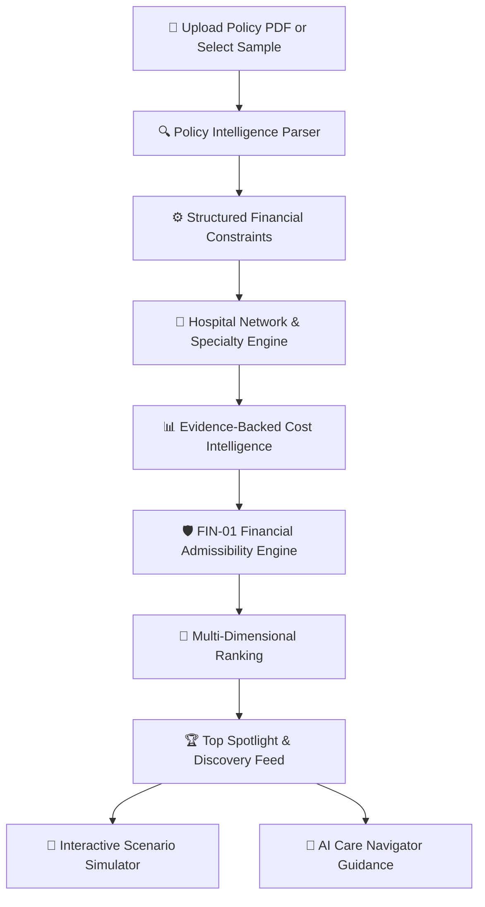

# 🏥 SehatSure (सेहतश्योर)

> **AI-Powered Healthcare Navigation, Insurance Policy Intelligence & Evidence-Backed Hospital Cost Engine**

[](https://sehat-sure-backend.onrender.com/)
[](https://opensource.org/licenses/MIT)
[](https://nodejs.org/)
[](https://react.dev/)
[](https://www.typescriptlang.org/)

---

### 🌐 Live Production Demo
👉 **[https://sehat-sure-backend.onrender.com/](https://sehat-sure-backend.onrender.com/)**

*Explore instant policy parsing, verified hospital network discovery, out-of-pocket bill breakdowns, and real-time scenario simulation on the live platform.*

---

## 📌 Executive Summary & Problem Statement

In India, healthcare emergencies are often accompanied by **financial shock at the hospital discharge desk**. While over 500 million citizens carry private health insurance, corporate group cover, or government schemes (such as Ayushman Bharat PM-JAY and ESIC), policyholders regularly face surprise out-of-pocket bills totaling 20% to 60% of their claims due to:

1. **Opaque Policy Clauses**: Cryptic clauses on room-rent ceilings (e.g., 1% of Sum Insured), proportionate deduction multipliers on surgical fees, disease-specific sublimits, and non-network co-payments.
2. **The "Room Rent Trap"**: Choosing a deluxe or single private room exceeding the policy's room limit triggers retroactive proportionate deductions across surgeon fees, nursing, and operation theater charges.
3. **In-Network Ambiguity**: Empanelled cashless hospital lists published by TPAs/insurers are fragmented, outdated, or difficult to filter by specific clinical procedure.
4. **Absence of Cost Benchmarks**: Patients have no standardized reference point for how much an angioplasty, knee replacement, or cholecystectomy should cost in their city.

**SehatSure** solves this by converting static, complex insurance policy documents into **deterministic financial constraints** and matching them with a **comprehensive hospital database** and **evidence-backed treatment cost benchmarks** to guide patients to the best clinical and financial care before admission.

---

## 💡 How It Works



1. **Policy Ingestion**: The user uploads their insurance policy schedule (or selects a pre-parsed corporate/retail/statutory policy).
2. **Deterministic Extraction**: The system extracts room rent limits, ICU allowances, proportionate deduction rules, co-payment rates, sublimits, and exclusions into structured JSON.
3. **Hospital Matching & Filtering**: Filters thousands of verified hospitals across major Indian cities (Pune, Mumbai, Bengaluru, Hyderabad, Delhi NCR, etc.) by clinical department, cashless empanelment, and location.
4. **Treatment Cost Intelligence**: Estimates treatment costs across 4 provenance tiers (Hospital Tariff, Regional Benchmark, National Average, or Statutory Government Packages).
5. **FIN-01 Admissibility & Out-of-Pocket Calculation**: Simulates claim admissibility, room rent deductions, consumables (5% private baseline), and co-pay to calculate the **exact expected patient out-of-pocket responsibility**.
6. **Decision Support & Simulation**: Delivers transparent bill breakdowns, AI care navigator next steps, and what-if scenario modeling.

---

## ✨ Key Architectural Features

### 1. 📄 Smart Policy Ingestion & Zero-Hallucination Extraction
- Supports standard Indian health insurance policies (HDFC ERGO, Star Health, Care Health, Niva Bupa, ICICI Lombard, New India Assurance, PM-JAY, ESIC).
- Extracts and standardizes:
  - **Sum Insured (SI)** & Cumulative Bonus
  - **Room Rent Limits**: Percentage of SI (e.g. 1%), fixed cap (₹2,500/day), or "Single Private A/C" / "No Capping"
  - **Proportionate Deductions**: Flags whether exceeding room rent triggers proportionate penalization of associated medical expenses
  - **Co-Payment Rules**: Zone-based, age-based, or non-network co-payments (e.g., 10%, 20%)
  - **Specific Ailment Sublimits**: Cataract, Joint Replacement, Hernia, Cardiac Procedures
  - **Explicit Exclusions**: Excluded treatments, cosmetic, maternity, or alternative medicine restrictions

### 2. 📊 Evidence-Backed Cost Intelligence (4 Provenance Tiers)
SehatSure avoids arbitrary estimations by organizing treatment costs across **4 evidence-backed benchmark levels**:

| Provenance Level | Description | Data Year & Source | Confidence |
| :--- | :--- | :--- | :--- |
| **Level A: Hospital-Specific Tariff** | Direct empirical tariff benchmark for the designated hospital. | 2024–2025 Audit Records | **High** |
| **Level B: Maharashtra / Regional Benchmark** | Empirical regional median costs adjusted for Metro/Tier-2 city indexing. | 2024 State Healthcare Benchmarks | **Medium** |
| **Level C: National Benchmark** | Pan-India clinical procedure averages normalized for procedural complexity. | 2023–2024 IRDAI / NHCX Trends | **Medium** |
| **Level D: Statutory Government Package** | Fixed statutory reference rates under statutory schemes (PM-JAY, CGHS, ESIC). | Statutory Gazette Schedules | **Statutory High** |

### 2.1 🤖 ML-Based Treatment-Cost Driver Analysis (FIN-01 AI Layer)
In addition to 4-tier benchmark lookups, SehatSure features a **supervised Machine Learning regression model** (Ridge Regularized Regressor, $\alpha=1.0$) trained on empirical private hospital tariff records (`pvt_costs.csv`, 184 rows) that learns multidimensional cost patterns:
- **Local Feature Attribution (Shapley-Equivalent)**: Explains *why* a procedure estimate is high or low across Procedure Complexity, Geographic Tier, Inpatient Duration, and Room Category tariffs.
- **Strict Non-Causal Wording**: Statements explicitly framed as correlation (*"Model indicates this feature strongly influences the estimate"*).
- **Anti-Hallucination & Domain Refusal**: Rejects unmodeled procedures and unsupported tiers with explicit `insufficient_data` states instead of extrapolating.
- **Strict Architectural Separation**: The ML layer estimates treatment cost patterns and drivers; insurance admissibility, room-rent disallowance, and patient out-of-pocket (OOP) remain **strictly governed by the deterministic FIN-01 financial engine**.
- Detailed specification, cross-validation metrics (10-fold MAE ₹45,423, grouped procedure holdout MAE ₹64,321), and training methodology are documented in [ML_TREATMENT_COST_DRIVER_ANALYSIS.md](file:///d:/BTECH/SEHATSURE/ML_TREATMENT_COST_DRIVER_ANALYSIS.md).

### 3. 🛡️ FIN-01 Financial Admissibility Matrix
- **Room Rent Disallowance**: Accurately computes per-day room excess based on chosen room tier (General, Twin Sharing, Single Private Room, Suite).
- **Proportionate Medical Expense Penalties**: Calculates deductions across doctor fees, nursing, and surgery charges when room limit is breached.
- **Non-Medical Consumable Modeling**: Models standard non-payable consumable overhead (5% baseline for commercial claims) unless a consumable rider applies.
- **Truth in Out-of-Pocket Display**: Only tags a hospital as `Zero Out-of-Pocket` when calculated patient responsibility is strictly ₹0; otherwise highlights the exact estimated out-of-pocket expense in INR.

### 4. 🏥 Multi-Dimensional Hospital Discovery
Users can toggle between three specialized recommendation modes tailored to their situation:
- **💎 Best Policy Coverage Fit**: Prioritizes facilities that minimize out-of-pocket expenditure and maximize policy admissibility.
- **🌟 Clinical Specialty Excellence**: Prioritizes centers of excellence with verified clinical volume and department readiness (Cardiology, Orthopedics, Oncology, Neurology, Nephrology, Gastroenterology, Urology, Gynecology).
- **📍 Nearest In-Network Proximity**: Discovers the closest verified cashless partners within the patient's selected city and locality.

### 5. 🔮 Interactive Scenario Simulator ("What-If" Engine)
Allows patients to simulate real-world decisions before entering the hospital:
- *What if I upgrade from Twin Sharing to a Single Private Room?*
- *What if procedure complexity increases by 20%?*
- *What if I activate a Consumables Waiver / Co-pay add-on?*
- Dynamically recalculates the entire insurance settlement and updates patient exposure in real time.

### 6. 🤖 SehatSure AI Care Navigator
- Generates clear, non-jargon policy guidance, pre-authorization preparation checklists, and TPA admission steps.
- Operates under strict guardrails: **Never hallucinates financial figures** and respects calculated mathematical admissibility.

---

## 🏗️ System Architecture

```text
┌────────────────────────────────────────────────────────────────────────┐
│                        React 18 + Vite Frontend                        │
│  - Modern Glassmorphism UI            - Interactive Scenario Simulator │
│  - City & Locality Filter Engine       - Bill Breakdown Modal (FIN-01)  │
│  - Multi-Mode Spotlight Triage         - AI Care Navigator Feed         │
└───────────────────────────────────┬────────────────────────────────────┘
                                    │ HTTP / REST (/api/*)
                                    ▼
┌────────────────────────────────────────────────────────────────────────┐
│                     Node.js + Express + TypeScript                     │
│ ┌──────────────────────┐ ┌──────────────────────┐ ┌──────────────────┐ │
│ │ Hospital Controller  │ │ Policy Intelligence  │ │ Cost Engine (CI) │ │
│ └──────────┬───────────┘ └──────────┬───────────┘ └────────┬─────────┘ │
│            │                        │                      │           │
│ ┌──────────▼───────────┐ ┌──────────▼───────────┐ ┌────────▼─────────┐ │
│ │ Network Matching     │ │ PDF Extraction &     │ │ 4-Tier Provenance│ │
│ │ & Locality Triage    │ │ Zod Schema Validator │ │ Benchmark Service│ │
│ └──────────┬───────────┘ └──────────┬───────────┘ └────────┬─────────┘ │
└────────────┼────────────────────────┼──────────────────────┼───────────┘
             │                        │                      │
             ▼                        ▼                      ▼
┌────────────────────────┐ ┌────────────────────┐ ┌──────────────────────┐
│     MongoDB Atlas      │ │ Google Gemini API  │ │ Empirical Datasets   │
│ - Hospital Records     │ │ - Policy Reasoning │ │ - Private Tariffs    │
│ - Verified Insurers    │ │ - Clinical Guidance│ │ - Govt Packages (CSV)│
│ - User Care Journeys   │ │   (No hallucination│ │ - Regional Baselines │
└────────────────────────┘ └────────────────────┘ └──────────────────────┘
```

---

## 🛠️ Technology Stack

| Layer | Technologies |
| :--- | :--- |
| **Frontend** | React 18, Vite, Vanilla Modern CSS, Lucide React Icons |
| **Backend** | Node.js, Express.js, TypeScript, Multer, PDFKit, pdf-parse |
| **Validation** | Zod (Schema validation and type inference) |
| **Database** | MongoDB Atlas, Mongoose ODM |
| **AI / LLM** | Google Gemini API (`gemini-2.5-flash` / `gemini-1.5-flash`) |
| **Datasets** | Empirical Private & Government Hospital Tariffs, IRDAI / NHCX Benchmark Matrices |
| **Deployment** | Render Unified Service (Single-port full-stack architecture) |

---

## 📁 Repository Structure

```text
SEHATSURE/
├── frontend/                     # React 18 + Vite Web Application
│   ├── src/
│   │   ├── components/           # Reusable UI (Modals, Badges, Simulator, Navbar)
│   │   ├── pages/                # Discovery, Care Journey, Upload, Login
│   │   ├── services/             # API client services (hospitalApi, authApi)
│   │   ├── index.css             # Unified Design System tokens & layout
│   │   └── App.jsx               # Application routing & state management
│   └── package.json
│
├── server/                       # Node.js + Express + TypeScript Backend
│   ├── src/
│   │   ├── controllers/          # Hospital, Policy, Journey, and Auth controllers
│   │   ├── models/               # Mongoose schemas (Hospital, Policy, Journey)
│   │   ├── routes/               # Express REST routes (/api/hospitals, /api/policies)
│   │   ├── services/             # Scoring, Cost Intelligence, Gemini AI service
│   │   ├── utils/                # PDF extractors, CSV parsers, math calculators
│   │   └── index.ts              # Express server initialization & static asset server
│   └── package.json
│
├── mock-policies/                # Sample policy PDFs for instant demo testing
├── treatment_cost_benchmarks.csv # 4-tier treatment cost dataset
├── govt_costs.csv                # Statutory PM-JAY & CGHS package rates
├── pvt_costs.csv                 # Private sector procedure tariff dataset
├── render.yaml                   # Render Blueprint infrastructure-as-code
├── DEPLOY.md                     # Render production deployment guide
└── README.md                     # Platform overview & documentation
```

---

## 🚀 Getting Started (Local Development)

### 1. Prerequisites
- **Node.js**: `v18.x` or higher
- **npm**: `v9.x` or higher
- **MongoDB**: Local MongoDB instance or free [MongoDB Atlas M0 Cluster](https://cloud.mongodb.com/)
- **Google Gemini API Key**: Free API key from [Google AI Studio](https://aistudio.google.com/app/apikey)

### 2. Clone the Repository
```bash
git clone https://github.com/Janmejay250171/SEHATSURE.git
cd SEHATSURE
```

### 3. Install All Dependencies
```bash
# Installs root, server, and frontend dependencies in one command
npm run install:all
```
*(Or install separately with `npm install`, `cd server && npm install`, `cd ../frontend && npm install`)*

### 4. Configure Environment Variables
Create a `.env` file in the root directory (based on `.env.example`):

```env
# MongoDB Connection URI
MONGODB_URI=mongodb+srv://<username>:<password>@cluster0.example.mongodb.net/sehatsure?retryWrites=true&w=majority

# Google Gemini API Key
GEMINI_API_KEY=your_gemini_api_key_here
GEMINI_MODEL=gemini-2.5-flash

# Server Configuration
PORT=5000
CLIENT_URL=http://localhost:5173
```

> **Security Note:** Never commit `.env` or real API keys to public version control. The repository includes a `.gitignore` to prevent secret leakage.

### 5. Seed Hospital & Cost Datasets (One-Time)
Seed the database with sample policies, hospitals, and procedure cost benchmarks:
```bash
npm run seed
```

### 6. Run the Application
Start both the backend server and frontend dev server concurrently:
```bash
npm run dev
```

- **Frontend**: [http://localhost:5173](http://localhost:5173)
- **Backend API**: [http://localhost:5000](http://localhost:5000)
- **API Health Check**: [http://localhost:5000/api/health](http://localhost:5000/api/health)

---

## 🧪 Testing & Verification

Run the test suite to verify cost calculation integrity, proportionate deduction accuracy, and API endpoints:

```bash
npm run test
```

The test suite validates:
- Room rent disallowance multipliers across tiers
- Consumable allowance handling (5% private vs. 0% statutory)
- Empanelled cashless network matching per insurer
- Strict consistency between ranking patient payable and breakdown total patient payable

---

## ☁️ Deployment

SehatSure is engineered as a **unified single-port service** optimized for platforms like **Render**, **Railway**, or **AWS**:
- The build script compiles the TypeScript backend to `server/dist/` and compiles the React application to `frontend/dist/`.
- In production, Express automatically serves the static Vite client bundle and handles client-side routing fallback while routing `/api/*` to REST endpoints.

See [DEPLOY.md](file:///d:/BTECH/SEHATSURE/DEPLOY.md) for step-by-step instructions.

---

## 🔒 Privacy, Security & Responsible AI

- **Data Privacy**: Uploaded policy documents are parsed in-memory; no personally identifiable medical records (PHI) are stored or shared.
- **Deterministic Financial Safeguards**: All monetary calculations (room rent caps, co-pays, out-of-pocket shares) are calculated deterministically by a verified mathematical rule engine, not generated by an LLM.
- **LLM Safety**: Gemini is used exclusively for unstructured text interpretation, clinical department extraction, and human-readable navigation explanations with strict prompt guardrails.

---

## ⚠️ Disclaimer

SehatSure is an **intelligent healthcare decision-support and decision-facilitation system** designed to clarify insurance terms and estimate out-of-pocket expenses. 

- It is **not an insurance company, insurance broker, or licensed third-party administrator (TPA)**.
- It does not constitute formal medical diagnosis, clinical advice, or legal policy underwriting.
- Final hospital bills and claim approvals depend on individual policy terms, treating doctor notes, hospital admission agreements, and final TPA adjudication. Patients should always verify active empanelment and room admissibility directly at the hospital insurance desk before admission.

---

## 👥 Authors & Acknowledgments

- **Lead Developer**: [Janmejay250171](https://github.com/Janmejay250171)
- Built for the **GE-PCC Hackathon 2026** to make Indian health insurance transparent, predictable, and patient-first.

⭐ **If you find SehatSure helpful, please consider starring the repository!**
