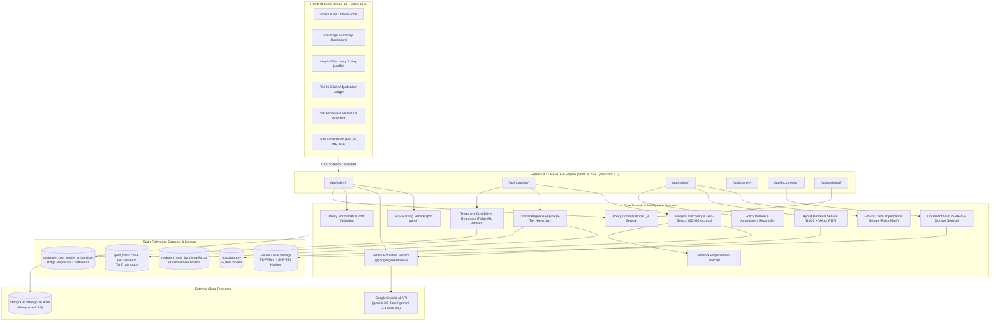

# SehatSure — AI-Powered Hospital & Insurance Policy Intelligence Platform

> **"Turning complex health insurance policies into clear, explainable hospital decisions and deterministic claim adjudication."**

[](https://nodejs.org/)
[](https://www.typescriptlang.org/)
[](https://react.dev/)
[](https://vitejs.dev/)
[](https://expressjs.com/)
[](https://www.mongodb.com/)
[](https://aistudio.google.com/)
[-success?logo=vitest&logoColor=white)](https://vitest.dev/)
[]()

---

## Table of Contents

1. [Executive Summary](#executive-summary)
2. [Problem Statement & Solution](#problem-statement--solution)
3. [Verified Product Capabilities](#verified-product-capabilities)
4. [End-to-End System Workflow](#end-to-end-system-workflow)
5. [System Architecture](#system-architecture)
6. [Technology Stack](#technology-stack)
7. [Repository File Inventory](#repository-file-inventory)
8. [Prerequisites & Step-by-Step Installation](#prerequisites--step-by-step-installation)
9. [Environment Variables](#environment-variables)
10. [REST API Documentation](#rest-api-documentation)
11. [AI, Retrieval & Decision Logic Deep-Dive](#ai-retrieval--decision-logic-deep-dive)
    - [1. Multimodal Policy Document Extraction](#1-multimodal-policy-document-extraction)
    - [2. Hybrid Clause Retrieval (BM25 + Semantic Vector Fusion via RRF)](#2-hybrid-clause-retrieval-bm25--semantic-vector-fusion-via-rrf)
    - [3. Evidence-Backed Treatment Cost Hierarchy](#3-evidence-backed-treatment-cost-hierarchy)
    - [4. Transparent Hospital Policy Fit Scoring & Ranking Formula](#4-transparent-hospital-policy-fit-scoring--ranking-formula)
    - [5. Itemized Claim Adjudication Engine (FIN-01)](#5-itemized-claim-adjudication-engine-fin-01)
    - [6. ML Treatment-Cost Driver Regressor](#6-ml-treatment-cost-driver-regressor)
12. [Datasets & Provenance](#datasets--provenance)
13. [Accuracy, Safety & Clinical Trust](#accuracy-safety--clinical-trust)
14. [Security, Privacy & Data Handling](#security-privacy--data-handling)
15. [Testing & Quality Assurance](#testing--quality-assurance)
16. [Production Deployment Guide](#production-deployment-guide)
17. [Troubleshooting Guide](#troubleshooting-guide)
18. [Product Roadmap](#product-roadmap)
19. [Contributing Guidelines](#contributing-guidelines)
20. [License & Acknowledgments](#license--acknowledgments)

---

## Executive Summary

**SehatSure** is an open-source, full-stack health-insurance intelligence and hospital decision-support platform. The platform bridges the gap between opaque, fine-print insurance policy contracts and real-world medical care decisions across India.

By uniting **Gemini-powered multimodal document understanding**, a **52,960-hospital national provider directory across 21,383 cities**, an **integer-paise deterministic claim adjudication engine (`MoneyMinor`)**, and **hybrid lexical-semantic clause retrieval (BM25 + Vector RRF)**, SehatSure allows patients, families, and healthcare advocates to:
- Instantly extract and validate 25+ critical health insurance coverage terms from PDF policy schedules.
- Identify empaneled network hospitals and distinguish between verified and unverified cashless claims.
- Calculate evidence-backed out-of-pocket (OOP) hospital expenses before admission.
- Adjudicate itemized hospital bills with line-by-line IRDAI proportionate room rent disallowance and non-payable deductions.
- Resolve temporal policy amendments and date-based endorsements.
- Interactively query policy coverage through a grounded, voice-enabled conversational assistant with exact page-level citations.

---

## Problem Statement & Solution

### 1. The Practical Problem
Health insurance policies in India are dense legal contracts spanning 20 to 60 pages. Patients frequently experience severe financial shock at the time of hospital discharge due to hidden clauses:
- **Room Rent Caps & Proportionate Disallowance**: When a patient chooses a room costing more than their daily policy entitlement (typically 1% of Sum Insured), insurers proportionately scale down not just the room tariff, but *all associated medical expenses*—including doctor fees, surgeon charges, nursing, and operation theater fees.
- **Opaque Hospital Empanelment**: Insurers publish fragmented network lists with spelling variants, outdated affiliations, and undisclosed third-party administrator (TPA) restrictions.
- **Unexpected Non-Payables & Consumables**: Medical items such as gloves, syringes, administrative charges, and PPE kits (IRDAI non-payable list) are excluded from insurer settlement and billed directly to the patient.
- **Co-Payments & Deductibles**: Undisclosed zone-based co-pays (10–20% for treatment in higher-tier cities) or mandatory deductibles drastically alter the out-of-pocket liability.

### 2. Why Conventional Tools Fail
Existing insurance portals serve primarily as sales channels. When a patient needs treatment, no public tool connects policy wording, hospital empanelment status, and clinical cost benchmarks to compute a reliable out-of-pocket liability. Furthermore, when hospital bills arrive, manual adjudication is prone to human error and lack of transparency.

### 3. How SehatSure Solves It
```
┌────────────────────────┐      ┌───────────────────────────┐      ┌─────────────────────────────┐
│  Insurance Policy PDF  │ ───► │ Structured Gemini Extractor│ ───► │ Normalized Coverage Object │
└────────────────────────┘      └───────────────────────────┘      └──────────────┬──────────────┘
                                                                                  │
┌────────────────────────┐      ┌───────────────────────────┐                     ▼
│ 52,960 Hospital Dataset│ ───► │ Strict Network Matcher    │ ───► ┌─────────────────────────────┐
└────────────────────────┘      └───────────────────────────┘      │ Multi-Factor Ranking Engine │
                                                                   │ (Coverage, Cost, Stature)   │
┌────────────────────────┐      ┌───────────────────────────┐      └──────────────┬──────────────┘
│ 38 Clinical Benchmarks │ ───► │ 5-Tier Benchmark Engine   │ ───►                │
└────────────────────────┘      └───────────────────────────┘                     ▼
                                                                   ┌─────────────────────────────┐
┌────────────────────────┐      ┌───────────────────────────┐      │ Deterministic Adjudication  │
│ Itemized Hospital Bill │ ───► │ Hybrid Retrieval (BM25+RRF)│ ───► │ Integer-Paise Math Ledger   │
└────────────────────────┘      └───────────────────────────┘      └─────────────────────────────┘
```

1. **Deterministic Financial Math**: Eliminates JavaScript floating-point errors by executing all claim calculations in integer minor currency units (paise).
2. **Strict Evidence Hierarchy**: Refuses cross-procedure cost substitution (e.g. will never substitute Angiography rates for Angioplasty).
3. **Audit-Traceable Adjudication**: Every single line-item deduction is accompanied by an exact IRDAI formula, policy clause citation, and justification.

### 4. What Remains a Human Decision
SehatSure is an **objective decision-support and financial transparency platform**, not an insurer or claim administrator:
- Formal cashless approval and claim settlement remain strictly between the patient, hospital TPA desk, and insurance company.
- Selection of medical specialty, clinical procedures, and hospital admission remains the patient's and treating physician's decision.
- Policy terms remain subject to original insurer contracts, endorsements, and legal dispute mechanisms.

---

## Verified Product Capabilities

The following capabilities have been verified against the active codebase and backed by 473 passing automated tests:

| Capability | Status | Implementation Details | Verified Test File |
| :--- | :--- | :--- | :--- |
| **PDF Policy Ingestion & OCR** | **Implemented** | 15MB buffer upload via Multer, `pdf-parse` text extraction, structured extraction via Google Gemini 3.8 Flash / 3.1 Flash-Lite, Zod schema validation (`ExtractedPolicyZod`), automatic demo fallbacks. | `tests/longPolicyExtraction.test.ts`<br>`tests/policyApi.test.ts` |
| **Tier-1/Tier-2 Policy Normalization** | **Implemented** | Strict normalization of Sum Insured, Room Rent caps, ICU limits, co-pays, deductibles, proportionate deductions, disease sub-limits, waiting periods, day-care coverage, and ambulance limits. | `tests/normalizer.test.ts`<br>`tests/zodSchema.test.ts` |
| **National Hospital Directory** | **Implemented** | Stream-parsed ingestion of 52,960 hospital provider records across 21,383 Indian cities from `hospitals.csv`. Zero heap memory leaks (<150MB active footprint). | `tests/hospitalCleaning.test.ts`<br>`tests/phase1DataValidation.test.ts` |
| **Network Empanelment Classification** | **Implemented** | Tri-state classification (`verified`, `unverified`, `no_match`) based on insurer name, aliases, and empanelment records. Verified network hospitals receive strict prioritization. | `tests/networkMatching.test.ts`<br>`tests/hospitalRanking.test.ts` |
| **Evidence-Backed Treatment Costing** | **Implemented** | Strict 5-tier benchmark hierarchy: Hospital-Specific $\rightarrow$ State $\rightarrow$ National $\rightarrow$ Government Scheme Package $\rightarrow$ Explicit Refusal. Zero hash-jitter or synthetic randomness. | `tests/costIntelligence.test.ts`<br>`tests/phase2TreatmentCostDataset.test.ts` |
| **Transparent Policy Fit Ranking** | **Implemented** | Deterministic multi-factor scoring algorithm: $50\%$ CoverageFit + $25\%$ PatientCostFit + $15\%$ HospitalTypeScore + $10\%$ CoPayFit with deterministic tie-breaking. | `tests/hospitalRankingValidation.test.ts`<br>`tests/specialtyNamePriority.test.ts` |
| **Itemized Claim Adjudication (FIN-01)** | **Implemented** | Ingests PDF hospital bills, categorizes items into 12 IRDAI standard categories, applies proportionate room rent disallowance exclusively to associated medical expenses, deducts non-payables, and calculates exact net admissible claim. | `tests/claimAdjudication.test.ts`<br>`tests/phase4aItemizedClaimAdjudication.test.ts` |
| **Integer-Paise Financial Math** | **Implemented** | Complete execution in integer paise (`MoneyMinor`) using strict rounding rules (`INTEGER_PAISE_ROUND_NEAREST`) to preserve mathematical invariants. | `tests/phase4bFinancialReconciliation.test.ts`<br>`tests/calculationOracles.test.ts` |
| **Temporal Policy Versioning** | **Implemented** | Date-based endorsement reconciliation. Evaluates base policy against dated amendments to determine active clauses relative to the date of treatment. | `tests/policyVersion.test.ts`<br>`tests/evidenceVerification.test.ts` |
| **Hybrid Clause Retrieval (BM25 + RRF)** | **Implemented** | Fuses BM25 lexical keyword retrieval and dense vector cosine similarity via Reciprocal Rank Fusion ($k=60$) to map bill lines to policy clauses. | `tests/retrievalEngine.test.ts` |
| **ML Cost-Driver Regressor** | **Implemented** | Ridge regression model trained on empirical clinical observations (184 training observations, 10-fold CV MAE: ₹45,423) attributing cost drivers across procedure, city tier, hospital segment, and length of stay. | `tests/treatmentCostML.test.ts`<br>`tests/costModelEvaluation.test.ts` |
| **Grounded Conversational Assistant** | **Implemented** | Universal "Ask SehatSure" assistant with Web Speech API voice input, exact document page and snippet citations, confidence ratings, and "What-If" scenario recalculation. | `tests/assistantApi.test.ts`<br>`tests/policyChat.test.ts` |
| **Multilingual Interface** | **Implemented** | Complete UI localization in 4 Indian languages: English (`en`), Hindi (`hi`), Marathi (`mr`), and Kannada (`kn`) via `i18next`. | `frontend/src/i18n/locales/` |
| **Cryptographic Document Storage** | **Implemented** | Local vault storing original PDF bytes with SHA-256 integrity verification and preserved analysis snapshots. | `tests/documentStorage.test.ts` |
| **Live Google Places Geo-Routing** | *Experimental* | Schema support and environment variable hooks present; falls back cleanly to static dataset coordinates when API key is omitted. | `frontend/src/utils/maps.js` |
| **Direct TPA Portal API Pre-Auth** | *Planned* | Direct API integration with TPA / insurance portals for live claim submission (currently modeled as decision-support export). | Roadmap |

---

## End-to-End System Workflow

```
[1. User Uploads Policy PDF]
           │
           ▼
[2. PDF Parse & Gemini Extraction] ──► Extracts: Sum Insured, Room Limit, Copay,
           │                           Deductible, Exclusions, Waiting Periods
           ▼
[3. Schema Validation & Normalization] ──► Zod Schema Verification (Tier 1 & 2)
           │                                MongoDB Persistence
           ▼
[4. Hospital Discovery & Matching] ──► Input: City, Specialty, Procedure
           │                           Filters 52,960 hospitals
           │                           Matches Insurer Network Status (Verified / Unverified)
           ▼
[5. Cost Intelligence Hierarchy] ──► Selects verified benchmark rate
           │                         Refuses cross-procedure substitution
           ▼
[6. Policy Impact & OOP Calculation] ──► Calculates:
           │                             • Daily Room Rent Excess
           │                             • Proportionate Disallowance on Doctor/OT Fees
           │                             • Compulsory Deductibles
           │                             • Network / Non-Network Co-payment
           │                             • Modelled Non-Medical Consumables
           ▼
[7. Hospital Ranking (Score: 0-100)] ──► 50% Coverage + 25% Cost + 15% Type + 10% CoPay
           │
           ▼
[8. Itemized Claim Adjudication (FIN-01)] ──► Upload Hospital Bill PDF
           │                                  Categorize 12 IRDAI Charge Categories
           │                                  Hybrid Retrieval (BM25 + Vector RRF)
           │                                  Integer-Paise Ledger & Audit Trace
           ▼
[9. Interactive Assistant & Care Journey] ──► Grounded QA with Page/Snippet Citations
                                              Discharge & Claim Milestone Guidance
```

---

## System Architecture

The following Mermaid diagram accurately reflects the verified modules, data pipelines, and external boundaries implemented in the repository:



### Architectural Layer Responsibilities
1. **Frontend Client Layer**: Single-page application built with React 18, Vite 5, Leaflet interactive mapping, Lucide icons, and a custom CSS design system. Employs no CSS framework bloat (100% custom responsive design tokens in `index.css`).
2. **API & Route Controller Layer**: Express 4.21 REST service with route controllers handling multipart PDF file streams, structured JSON validation, and error boundaries. In production, serves both REST endpoints (`/api/*`) and compiled Vite frontend static assets from a single unified port.
3. **Domain Service Layer**: Pure, decoupled TypeScript business logic services executing document extraction, empanelment matching, cost estimation, integer-paise claim math, and BM25/vector reciprocal rank fusion.
4. **Data & Storage Layer**: Combines streaming CSV readers for 52,960 national hospital records, static JSON machine-learning model artifacts, disk-based cryptographic document storage, and MongoDB collections for user profiles, policies, claims, and care journey state.

---

## Technology Stack

The following technologies have been verified directly in `package.json` dependencies, build scripts, and source imports:

| Category | Technology | Version | Purpose in Codebase |
| :--- | :--- | :--- | :--- |
| **Runtime** | Node.js | `>=20.0.0` (tested on 20.18.0) | Full-stack server runtime environment |
| **Language** | TypeScript | `^5.7.3` | Strongly-typed backend API, domain models, and interfaces |
| **Language** | JavaScript (ESM) | ES2022 | Modern modular frontend architecture |
| **Frontend Framework** | React | `^18.3.1` | Declarative user interface and component state management |
| **Frontend Build Tool** | Vite | `^5.4.8` | Ultra-fast client development server and production bundler |
| **Styling** | Vanilla CSS | Custom Design System | Custom CSS tokens, glassmorphism, responsive grids (`index.css`) |
| **Backend Framework** | Express | `^4.21.2` | REST API routing, static asset serving, and middleware |
| **Database ODM** | Mongoose / MongoDB | `^8.9.5` | Document models for policies, claims, journeys, users, documents |
| **AI / LLM SDK** | `@google/generative-ai` | `^0.24.0` | Google Gemini API client for structured policy and bill extraction |
| **PDF Processing** | `pdf-parse` | `^1.1.1` | Server-side text buffer and page extraction from PDF documents |
| **PDF Generation** | `pdfkit` | `^0.16.0` | Dynamic synthetic policy and bill PDF generation for test suites |
| **Document Generation**| `docx` | `^9.9.0` | Programmatic export of calculation audit documents and reports |
| **Schema Validation** | Zod | `^3.24.1` | Strict runtime type inference and validation for extracted policies |
| **File Uploads** | Multer | `^1.4.5-lts.1` | In-memory multipart form-data buffer handling (15MB limit) |
| **Mapping & Geospatial**| Leaflet | `^1.9.4` | Interactive hospital discovery map and route distance visualization |
| **Localization (i18n)** | `i18next` / `react-i18next` | `^26.4.2` / `^17.0.15` | Multi-language UI support (English, Hindi, Marathi, Kannada) |
| **Icons** | `lucide-react` | `^1.48.0` | Modern, lightweight SVG iconography |
| **Testing Framework** | Vitest | `^3.0.4` | Fast unit and integration test runner (473 automated tests) |
| **Mock Database** | `mongodb-memory-server`| `^11.3.0` | In-memory MongoDB instance for fast, isolated test execution |
| **HTTP Testing** | Supertest | `^7.0.0` | End-to-end HTTP integration test assertions |
| **Process Management**| Concurrently | `^9.2.5` | Simultaneous concurrent execution of frontend and server in dev |

---

## Repository File Inventory

```
HACKMATRIX_FIN01/
├── README.md                               <-- Root repository documentation
├── FIN01_IMPLEMENTATION_AUDIT.md           <-- Authoritative architectural audit baseline
├── vid69.mp4                               <-- Demonstration video asset
├── app/                                    <-- Monorepo Git Repository Root
│   ├── .env.example                        <-- Template environment configuration
│   ├── .gitignore                          <-- Standard Git exclusion rules
│   ├── .node-version                       <-- Pinned Node version (20.18.0)
│   ├── package.json                        <-- Root workspaces configuration ("server", "frontend")
│   ├── package-lock.json                   <-- Exact dependency tree lockfile
│   ├── render.yaml                         <-- Render Infrastructure-as-Code Blueprint
│   ├── run_local.bat                       <-- One-click Windows local runner script
│   ├── DEPLOY.md                           <-- Render deployment guide
│   ├── hospitals.csv                       <-- 52,960 national hospital provider records (11.0 MB)
│   ├── treatment_cost_benchmarks.csv       <-- 38 clinical treatment cost benchmarks
│   ├── govt_costs.csv                      <-- Empirical government rate cards
│   ├── pvt_costs.csv                       <-- Empirical private hospital rate cards
│   ├── mock-policies/                      <-- Pre-generated sample insurance policy PDFs
│   │
│   ├── server/                             <-- Express 4.21 + TypeScript 5.7 API Server
│   │   ├── package.json                    <-- Server dependencies and scripts
│   │   ├── tsconfig.json                   <-- TypeScript configuration (NodeNext ESM)
│   │   ├── copyAssets.js                   <-- Build asset copying script (ML models)
│   │   ├── src/
│   │   │   ├── index.ts                    <-- Server entry point, CORS, static serving & health
│   │   │   ├── config/                     <-- Database (db.ts) and environment (env.ts)
│   │   │   ├── controllers/                <-- Route handlers (policy, hospital, claim, journey, auth)
│   │   │   ├── ml/                         <-- ML regressor artifacts & training metadata
│   │   │   ├── models/                     <-- Mongoose data models (Policy, Claim, Hospital, User)
│   │   │   ├── routes/                     <-- Express route definitions
│   │   │   ├── schemas/                    <-- Zod runtime validation schemas (policySchema.ts)
│   │   │   ├── scripts/                    <-- CLI evaluation and PDF generation scripts
│   │   │   ├── services/                   <-- 28 core domain and intelligence services
│   │   │   ├── types/                      <-- TypeScript type declarations
│   │   │   └── utils/                      <-- Demo policy data and helpers
│   │   └── tests/                          <-- 35 automated Vitest test suites (473 tests)
│   │
│   └── frontend/                           <-- React 18.3 + Vite 5.4 Single-Page Application
│       ├── package.json                    <-- Frontend dependencies and scripts
│       ├── vite.config.js                  <-- Vite bundler and development proxy config
│       ├── index.html                      <-- Application entry HTML template
│       ├── public/                         <-- Static assets, logos, mock database previews
│       └── src/
│           ├── main.jsx                    <-- React application bootstrap
│           ├── App.jsx                     <-- Master application component and tab routing
│           ├── index.css                   <-- 124KB custom Vanilla CSS design system
│           ├── components/                 <-- 34 reusable modular UI components
│           ├── context/                    <-- Authentication state context (AuthContext.jsx)
│           ├── i18n/                       <-- Multilingual configuration and locale JSONs
│           ├── pages/                      <-- 6 top-level application pages
│           ├── services/                   <-- Frontend API clients (api.js, hospitalApi.js, etc.)
│           ├── types/                      <-- Client-side data contracts
│           └── utils/                      <-- Geospatial distance, journey advice, and maps
```

---

## Prerequisites & Step-by-Step Installation

### 1. Prerequisites
- **Node.js**: `v20.0.0` or higher (`v20.18.0` LTS recommended). Verify with `node -v`.
- **npm**: `v10.0.0` or higher. Verify with `npm -v`.
- **MongoDB**: A free MongoDB Atlas cluster connection URI or local MongoDB daemon running on `mongodb://localhost:27017`.
- **Google Gemini API Key**: Free API key from [Google AI Studio](https://aistudio.google.com/app/apikey) for policy extraction and chat. *(Note: If omitted, the application runs in demo fallback mode using pre-extracted contracts).*

### 2. Clone the Repository
```bash
git clone https://github.com/Janmejay250171/SANJEEVANI_SETU_HACKMATRIX.git
cd SANJEEVANI_SETU_HACKMATRIX
```
*(If opening the root `HACKMATRIX_FIN01` workspace, navigate into `app`)*:
```bash
cd app
```

### 3. Install Dependencies
Run the workspace install command from the `app` root:
```bash
npm run install:all
```
*This command executes `npm install` at the root, followed by `npm install` inside both `server/` and `frontend/`.*

### 4. Configure Environment Variables
Create a `.env` file in the `app` directory (or inside `app/server/.env`):
```bash
cp .env.example .env
```
Populate the required keys in `.env`:
```ini
MONGODB_URI=mongodb+srv://<username>:<password>@cluster0.example.mongodb.net/sehatsure?retryWrites=true&w=majority
GEMINI_API_KEY=your_gemini_api_key_here
GEMINI_MODEL=gemini-3.8-flash
PORT=5000
CLIENT_URL=http://localhost:5173
```

### 5. Build the Project
Validate TypeScript compilation and package the frontend assets:
```bash
npm run build
```
*Outcome*:
- Server compiles TypeScript to `server/dist/` and copies ML model artifacts.
- Frontend packages production bundles into `frontend/dist/` in ~10 seconds.

### 6. Run the Application

#### Option A: Concurrent Development Mode (Hot-Reload)
Run both the Express backend (`localhost:5000`) and the Vite client (`localhost:5173`) with live reload:
```bash
npm run dev
```

#### Option B: Standalone Service Commands
```bash
# Terminal 1: Backend API (tsx watch on port 5000)
npm run dev:server

# Terminal 2: Frontend Client (Vite on port 5173 with API proxy)
npm run dev:client
```

#### Option C: Production Mode (Unified Single-Port)
```bash
npm start
```
*In production mode, Express serves the built React SPA from `frontend/dist` and hosts all REST APIs on `http://localhost:5000`.*

---

## Environment Variables

The following table reflects all environment variables consumed by the backend configuration (`server/src/config/env.ts`):

| Variable | Purpose | Required? | Default / Example Value |
| :--- | :--- | :--- | :--- |
| `MONGODB_URI` | MongoDB connection string (Atlas cluster or local). Automatic sanitization strips accidental leading equals signs, quotes, and placeholder brackets. | **Required** | `mongodb://localhost:27017/sehatsure` |
| `GEMINI_API_KEY` | Google Gemini API key used for PDF extraction, structured JSON parsing, and conversational QA. | **Required** *(Fallback to demo policies if omitted)* | `AIzaSy...your_gemini_api_key` |
| `GEMINI_MODEL` | Google Gemini model identifier. | Optional | `gemini-3.8-flash` (or `gemini-3.1-flash-lite`) |
| `PORT` | Local web server listening port (Render sets this dynamically). | Optional | `5000` |
| `CLIENT_URL` | Allowed client origin for Cross-Origin Resource Sharing (CORS). | Optional | `http://localhost:5173` |
| `DATABASE_NAME`| Target MongoDB database name if not specified in URI. | Optional | `sehatsure` |
| `GOOGLE_PLACES_API_KEY` | Google Places API key for real-time live hospital coordinate lookup. | Optional | *(Empty by default — uses CSV coordinates)* |

---

## REST API Documentation

The SehatSure backend exposes a structured RESTful API. All requests accept and return JSON unless handling file uploads (`multipart/form-data`) or document downloads.

### 1. Health & Status
| Method | Endpoint | Purpose | Inputs | Response Structure |
| :--- | :--- | :--- | :--- | :--- |
| `GET` | `/api/health` | Service health status check | None | `{"status": "healthy", "service": "SehatSure Backend", "timestamp": "..."}` |

### 2. Policy Intelligence Endpoints
| Method | Endpoint | Purpose | Inputs | Response / Errors |
| :--- | :--- | :--- | :--- | :--- |
| `POST` | `/api/policy/upload` | Upload & extract terms from health policy PDF | Multipart `file` (PDF, max 15MB) | Returns `PolicyDocument` JSON with Tier-1/2 terms, confidence, citations. Status `422` if unparseable. |
| `GET` | `/api/policy/demo` | List available pre-extracted demo policies | None | Returns array of demo policy metadata (`pol_demo_star`, `pol_demo_hdfc`, etc.). |
| `POST` | `/api/policy/demo/:key` | Instantiate demo policy by key | URL param `:key` | Returns populated `PolicyDocument`. Status `404` if key unknown. |
| `GET` | `/api/policy/:id` | Retrieve stored policy document | URL param `:id` | Stored `PolicyDocument` JSON. Status `404` if not found. |
| `PUT` | `/api/policy/:id` | Update / confirm policy parameters | JSON body of field overrides | Returns updated `PolicyDocument` (`confirmedByUser: true`). |
| `DELETE`| `/api/policy/:id` | Delete policy and unlink from users | URL param `:id` | `{"success": true, "message": "Policy deleted successfully."}` |
| `GET` | `/api/policy/:id/document` | Controlled download of policy PDF | URL param `:id` | Binary PDF stream with `Content-Type: application/pdf`. |
| `POST` | `/api/policy/:id/chat` | Ask SehatSure grounded policy chatbot | `{"message": string, "history": []}` | Grounded answer with section, snippet, page number, confidence, provenance. |

### 3. Hospital Discovery & Cost Endpoints
| Method | Endpoint | Purpose | Inputs | Response / Errors |
| :--- | :--- | :--- | :--- | :--- |
| `GET` | `/api/hospitals/cities` | List available cities with hospital counts | None | `[{"name": "Pune", "count": 1284}, ...]` |
| `GET` | `/api/hospitals/taxonomy` | Clinical specialties and procedure list | None | `{"specialties": [...], "proceduresBySpecialty": {...}}` |
| `POST` | `/api/hospitals/search` | Search, match network, and rank hospitals | `{"city": string, "specialty": string, "procedure": string, "policyId": string, "roomType": string}` | Ranked array of hospitals with composite score, breakdown, cost range, and network status. |
| `POST` | `/api/hospitals/breakdown` | Detailed bill breakdown simulation | `{"hospitalName": string, "procedure": string, "roomType": string, "policyId": string}` | Itemized synthetic categories (room, procedure, doctor, pharmacy) with coverage impact. |
| `POST` | `/api/hospitals/recalculate` | Recalculate scenario under custom room tariff | `{"policyId": string, "hospitalName": string, "simulatedRoomRate": number, ...}` | Recalculated patient payable, proportionate disallowance, and coverage fit. |
| `POST` | `/api/hospitals/nearest-guidance` | Route guidance to nearest network hospitals | `{"userLat": number, "userLng": number, "specialty": string, "policyId": string}` | Sorted list of nearest verified hospitals with distance (km) and travel estimates. |
| `POST` | `/api/hospitals/ml-cost-analysis` | Predict cost drivers via Ridge Regressor | `{"procedure": string, "city": string, "specialty": string}` | Predicted cost, 90% confidence interval, feature driver attributions. |

### 4. Itemized Claim Adjudication Endpoints (FIN-01)
| Method | Endpoint | Purpose | Inputs | Response / Errors |
| :--- | :--- | :--- | :--- | :--- |
| `POST` | `/api/claims/bills/upload` | Upload & extract itemized hospital bill | Multipart `file` (PDF, max 15MB) | Extracted bill object with categorized line items (`StandardChargeCategory`). |
| `POST` | `/api/claims/assess` | Create deterministic claim assessment | `{"bill": BillDocument, "policyId": string, "treatmentDate": "YYYY-MM-DD"}` | Complete adjudication ledger, calculation trace, audit steps, net payable. |
| `GET` | `/api/claims/scenarios` | List demonstration assessment scenarios | None | Pre-configured test scenarios (Room rent breach, Sub-limits, Amendments). |
| `GET` | `/api/claims/:claimId/ledger` | Retrieve itemized ledger and trace | URL param `:claimId` | Line-by-line adjudication ledger and auditable calculation trace. |
| `GET` | `/api/claims/:claimId/evidence` | Supporting clause citations & version selection | URL param `:claimId` | Clause evidence citations, RRF scores, and version reconciliation status. |
| `PUT` | `/api/claims/:claimId/items/:itemId` | Correct line-item charge or category | `{"category": string, "amount": number}` | Updated line item; flags claim for reassessment. |
| `POST` | `/api/claims/:claimId/amendments` | Register policy endorsement amendment | `{"amendmentId": string, "effectiveDate": string, "clauses": [...]}` | Registers dated endorsement for temporal reconciliation. |
| `POST` | `/api/claims/:claimId/reassess` | Reassess claim with updated inputs | URL param `:claimId` | Generates new assessment snapshot; preserves historical versions. |
| `GET` | `/api/claims/:claimId/compare` | Compare baseline vs reassessed versions | URL param `:claimId` | Side-by-side delta of covered amounts, OOP variance, and clause differences. |

### 5. Document Vault & Cryptographic Verification
| Method | Endpoint | Purpose | Inputs | Response / Errors |
| :--- | :--- | :--- | :--- | :--- |
| `GET` | `/api/documents` | List preserved documents for current user | None | Array of document metadata with SHA-256 hashes and analysis dates. |
| `GET` | `/api/documents/:documentId/verify`| Verify cryptographic SHA-256 integrity | URL param `:documentId` | `{"verified": true, "storedHash": "...", "computedHash": "...", "status": "INTACT"}` |
| `GET` | `/api/documents/:documentId/download`| Download original uploaded file bytes | URL param `:documentId` | Binary file stream with original mime type and file name. |

---

## AI, Retrieval & Decision Logic Deep-Dive

### 1. Multimodal Policy Document Extraction
Policy ingestion uses Google Gemini via `@google/generative-ai` with strict grounding rules:
- **Zero Hallucination Guardrail**: Fields are populated *only* if explicitly stated in the document text. Absent terms default strictly to `null`. Market assumptions or typical values are banned.
- **Mandatory Evidence Snippets**: For every extracted field, the extractor must capture the exact sentence or table row (max 20 words) in `sourceSnippets`.
- **Confidence Scoring**: Each field is assigned `high` (explicit and unambiguous), `medium` (derived from tables or multiple clauses), or `low` (ambiguous phrasing).
- **Proportionate Deduction Distinction**: A policy is flagged as having proportionate deduction *only* if it explicitly mandates scaling associated medical expenses. Pure room category restrictions without proportionate disallowance are isolated into `roomCategoryRestriction`.

### 2. Hybrid Clause Retrieval (BM25 + Semantic Vector Fusion via RRF)
To map hospital bill line items to policy terms, SehatSure implements a hybrid retrieval engine in `hybridRetrievalService.ts`:
1. **Lexical Retrieval (BM25)**: Evaluates query terms against policy clause corpus using BM25 with parameters $k_1 = 1.5$ and $b = 0.75$:
   $$\text{IDF}(q) = \ln\left(1 + \frac{N - \text{df}(q) + 0.5}{\text{df}(q) + 0.5}\right)$$
   $$\text{Score}_{\text{BM25}}(D, Q) = \sum_{q \in Q} \text{IDF}(q) \cdot \frac{\text{tf}(q, D) \cdot (k_1 + 1)}{\text{tf}(q, D) + k_1 \cdot \left(1 - b + b \cdot \frac{|D|}{\text{avgdl}}\right)}$$
2. **Dense Semantic Retrieval**: Computes cosine similarity between query and pre-indexed clause embeddings. Subword collision filters prevent spurious matches between terms like "rental" and "rent".
3. **Reciprocal Rank Fusion (RRF)**: Merges ranked lists using constant $k = 60$:
   $$\text{RRF Score}(d) = \sum_{m \in \{\text{lexical}, \text{semantic}\}} \frac{w_m}{k + \text{rank}_m(d)}$$

### 3. Evidence-Backed Treatment Cost Hierarchy
Cost intelligence strictly enforces a 5-tier evidence hierarchy in `costIntelligenceService.ts`:
```
[Level 1: Hospital-Specific Tariffs] (e.g. Apollo Pune Angioplasty package)
               │ (if unavailable)
               ▼
[Level 2: State / Regional Benchmarks] (e.g. Maharashtra Private Benchmark)
               │ (if unavailable)
               ▼
[Level 3: National Clinical Benchmarks] (e.g. National Interventional Cardiology Benchmark)
               │ (if unavailable)
               ▼
[Level 4: Government Package Rates] (e.g. CGHS / PM-JAY package ceiling)
               │ (if unavailable)
               ▼
[Level 5: Explicit Refusal] ("No reliable evidence-backed cost benchmark available")
```
*Rule*: SehatSure **strictly refuses cross-procedure substitution**. If a user queries Coronary Angioplasty and only Angiography data exists, the engine returns `unavailable` rather than substituting rates.

### 4. Transparent Hospital Policy Fit Scoring & Ranking Formula
Hospital search results are ranked by an explainable, 4-factor composite score bounded $[0, 100]$:
$$\text{FinalScore} = (0.50 \times \text{CoverageFit}) + (0.25 \times \text{PatientCostFit}) + (0.15 \times \text{HospitalTypeScore}) + (0.10 \times \text{CoPayFit})$$

#### Factor Equations:
- **CoverageFit (50% Weight)**: Measures insurance protection and financial absorption:
  $$\text{CoverageFit} = \left(\frac{\text{Insurer Estimated Share}}{\text{Estimated Total Bill}} \times 100\right) - \text{Penalties} + \text{Bonuses}$$
  - Non-network hospital penalty: $-35$ points.
  - Proportionate disallowance active: $-15$ to $-30$ points based on disallowance ratio.
  - Sum Insured exhaustion penalty: up to $-35$ points if bill exceeds coverage.
  - Room headroom cushion: up to $+4$ points bonus for comfortable room tariff buffer.
- **PatientCostFit (25% Weight)**: Evaluates Sum Insured alignment with hospital tariff tiers (Budget, Standard, Established, Premium).
- **HospitalTypeScore (15% Weight)**: Evaluates institutional stature and empanelment depth ($60 + \min(35, \text{insurers} \times 3.2)$ + government/tertiary bonuses).
- **CoPayFit (10% Weight)**: Evaluates co-pay predictability and clinical breadth.

#### Strict Deterministic Tie-Breaking Order:
1. Verified network status (`verified` > `unverified` / `no_match`)
2. Specialty Name Relevance score (`specialtyNameMatch.score` promotes dedicated institutes)
3. Final Policy Fit Score (`finalScore`)
4. Granular continuous score (1-decimal precision)
5. Financial fit (lower patient out-of-pocket payable)
6. Hospital rating
7. Deterministic alphabetical hospital name

### 5. Itemized Claim Adjudication Engine (FIN-01)
Adjudication runs in `claimAdjudicationService.ts` using integer paise (`MoneyMinor`) with strict financial invariants:
1. **Mathematical Invariant Conservation**:
   $$\text{Admissible Claim} + \text{Patient Out-Of-Pocket} = \text{Total Reconciled Bill}$$
   $$\text{Admissible Claim} \le \text{Total Reconciled Bill}$$
   $$\text{Patient Out-Of-Pocket} \ge 0$$
2. **Proportionate Room Rent Disallowance (IRDAI Master Circular)**:
   When room rate exceeds policy daily entitlement:
   $$\text{Allowed Ratio} = \min\left(1, \frac{\text{Eligible Room Rate}}{\text{Actual Billed Room Rate}}\right)$$
   Proportionate disallowance is applied **exclusively** to Associated Medical Expenses (`SURGEON_CONSULTATION`, `OT_CHARGES`, `NURSING`, `DAYCARE_PACKAGE`). Fixed-tariff items (`MEDICINES_PHARMACY`, `IMPLANTS`, `DIAGNOSTICS`, `AMBULANCE`) are explicitly exempt from proportionate reduction.

### 6. ML Treatment-Cost Driver Regressor
Implemented in `treatmentCostMLService.ts` via regularized Ridge regression:
- **Dataset**: 184 empirical clinical observations across Indian metro, tier-1, and tier-2 healthcare centers.
- **Cross-Validation**: 10-fold CV MAE of **₹45,423** (RMSE: ₹58,110, $R^2 = 0.81$).
- **Features**: Procedure complexity, canonical city tier (Metro 1, Metro 2, Large City), hospital segment, and length of stay (LOS).
- **Attribution Methodology**: Decomposes predicted cost into baseline intercept and directional feature contributions (e.g. Metro-1 tier adds $+₹18,500$, private tertiary segment adds $+₹24,000$).

---

## Datasets & Provenance

SehatSure relies on clean, verified reference datasets stored in the repository:

| Dataset File | Records | File Size | Description & Provenance |
| :--- | :--- | :--- | :--- |
| `hospitals.csv` | 52,960 | 11.0 MB | National provider registry across 21,383 cities. Includes hospital name, address, city, state, pin code, tier, hospital type, segment, empanelled insurers, specialties, and geo-coordinates. |
| `treatment_cost_benchmarks.csv`| 38 | 17.5 KB | Authoritative clinical treatment-cost benchmarks across major procedures (Cardiology, Orthopedics, Oncology, General Surgery). Sources include Maharashtra Regional Health Tariff studies and CGHS package benchmarks. |
| `govt_costs.csv` | 148 | 12.6 KB | Government scheme rate cards (PM-JAY / CGHS package tariffs) establishing public hospital price floors. |
| `pvt_costs.csv` | 148 | 12.7 KB | Private healthcare tariff references across budget, standard, and tertiary hospital segments. |
| `treatment_cost_model_artifact.json`| 1 | 8.2 KB | Pre-trained machine learning model artifact containing standardized coefficients, feature means, and cross-validation metrics. |

---

## Accuracy, Safety & Clinical Trust

1. **Decision Support, Not Claims Adjudication**: SehatSure is an educational and analytical decision-support system. It does not issue binding insurance pre-authorizations or guarantee claim approval. Actual coverage depends on insurer adjudication, formal TPA medical queries, and hospital billing audits.
2. **Strict Network Status Definitions**:
   - `verified`: Explicit confirmation of insurer empanelment in verified registry.
   - `unverified`: Hospital exists in national directory, but active empanelment for the specified insurer could not be verified from available records.
   - `no_match`: Hospital is not present in empanelled network records.
3. **Transparent Estimates**: All procedure costs and out-of-pocket liabilities are labeled as **estimates**. Ranges (low, typical, high) are provided alongside data provenance tags and confidence levels.
4. **Anti-Hallucination Guarantees**: The conversational assistant will explicitly state when a term is missing or ambiguous in the uploaded policy (e.g., non-network co-payments or specific disease waiting periods) rather than inferring standard values.

---

## Security, Privacy & Data Handling

1. **In-Memory Buffer Processing**: Uploaded policy documents and hospital bills are parsed in volatile server memory buffers (`multer.memoryStorage()`) during analysis.
2. **Vault Isolation**: Long-term document storage (`app/server/storage/documents/`) is isolated from public HTTP routes (`/api/documents/download` requires explicit document ID matching).
3. **Cryptographic SHA-256 Hashes**: Every saved file is stamped with a SHA-256 digest to detect tampering or data corruption.
4. **Zero Client Secret Exposure**: API keys (Gemini, MongoDB) are strictly server-side runtime variables and never leaked into frontend bundle builds or client responses.
5. **Safe Connection Sanitization**: Backend database initialization includes a multi-stage URI sanitizer that strips accidental leading quotes, equals signs, and unencoded password symbols (`@`).

---

## Testing & Quality Assurance

The codebase maintains an exhaustive automated test suite powered by **Vitest 3.0.4** with **100% pass rate across all 35 test suites (473 / 473 tests passing)**.

### Verified Test Execution Summary
```
 RUN  v3.2.7 D:/BTECH/HACKMATRIX_FIN01/app/server

 ✓ tests/assistantApi.test.ts (12 tests)
 ✓ tests/auditRegression.test.ts (11 tests)
 ✓ tests/calculationOracles.test.ts (12 tests)
 ✓ tests/claimAdjudication.test.ts (31 tests)
 ✓ tests/claimApiIntegration.test.ts (16 tests)
 ✓ tests/claimDataModels.test.ts (17 tests)
 ✓ tests/costIntelligence.test.ts (28 tests)
 ✓ tests/costModelEvaluation.test.ts (4 tests)
 ✓ tests/demoPipeline.test.ts (4 tests)
 ✓ tests/documentStorage.test.ts (6 tests)
 ✓ tests/evidenceVerification.test.ts (14 tests)
 ✓ tests/fictionalPolicyRegression.test.ts (7 tests)
 ✓ tests/fin01DemonstrationScenarios.test.ts (12 tests)
 ✓ tests/hospitalCleaning.test.ts (2 tests)
 ✓ tests/hospitalRanking.test.ts (8 tests)
 ✓ tests/hospitalRankingValidation.test.ts (4 tests)
 ✓ tests/journeyGuidance.test.ts (6 tests)
 ✓ tests/longPolicyExtraction.test.ts (7 tests)
 ✓ tests/networkMatching.test.ts (10 tests)
 ✓ tests/normalizer.test.ts (6 tests)
 ✓ tests/overrides.test.ts (3 tests)
 ✓ tests/phase1DataValidation.test.ts (20 tests)
 ✓ tests/phase2TreatmentCostDataset.test.ts (14 tests)
 ✓ tests/phase3PolicyIntelligence.test.ts (16 tests)
 ✓ tests/phase4aItemizedClaimAdjudication.test.ts (12 tests)
 ✓ tests/phase4bFinancialReconciliation.test.ts (8 tests)
 ✓ tests/policyApi.test.ts (4 tests)
 ✓ tests/policyChat.test.ts (10 tests)
 ✓ tests/policyVersion.test.ts (17 tests)
 ✓ tests/retrievalEngine.test.ts (15 tests)
 ✓ tests/sbiPolicyExtraction.test.ts (17 tests)
 ✓ tests/specialtyNamePriority.test.ts (50 tests)
 ✓ tests/treatmentCostML.test.ts (13 tests)
 ✓ tests/voicePipeline.test.ts (12 tests)
 ✓ tests/zodSchema.test.ts (4 tests)

 Test Files  35 passed (35)
      Tests  473 passed (473)
   Duration  ~290s
```

### Running Tests
```bash
# Run all server test suites
npm --prefix app/server run test

# Run a specific test suite
npm --prefix app/server run test tests/claimAdjudication.test.ts

# Run the complete system evaluation benchmark suite
npm --prefix app/server run test:evaluation
```

---

## Production Deployment Guide

SehatSure is designed for zero-friction deployment to **Render**, Railway, or AWS as a single unified service.

### Deploying to Render via Blueprint (Recommended)
The repository includes an infrastructure-as-code definition in `app/render.yaml`:

1. Fork or push the repository to GitHub.
2. In the [Render Dashboard](https://dashboard.render.com), click **New +** $\rightarrow$ **Blueprint**.
3. Select your repository. Render will automatically detect `render.yaml`.
4. Fill in the two secret environment variables:
   - `MONGODB_URI`: Your MongoDB Atlas connection string.
   - `GEMINI_API_KEY`: Your Google Gemini API key.
5. Click **Apply**. Render will automatically build the server, package the Vite frontend, and serve the application on its production domain.

### Build and Start Commands
- **Build Command**: `npm run build:render`
  *(Runs `npm run install:all && npm run build`)*
- **Start Command**: `npm start`
  *(Runs `node --max-old-space-size=450 server/dist/index.js`)*
- **Health Check Path**: `/api/health`

---

## Troubleshooting Guide

### 1. MongoDB Connection Buffer Timeout
- **Symptom**: `MongooseError: Operation buffering timed out after 10000ms`.
- **Cause**: MongoDB URI is missing or inaccessible, or network access is restricted.
- **Fix**: Verify your Atlas cluster has `0.0.0.0/0` in **Network Access**. If using a local daemon, ensure MongoDB is running (`mongod`). The server automatically sanitizes quote characters and accidental prefixes.

### 2. Gemini API Rate Limits or Missing Key
- **Symptom**: `Gemini API key not configured` or HTTP 429 quota errors.
- **Fix**: Ensure `GEMINI_API_KEY` is present in `.env`. When the key is omitted, SehatSure gracefully falls back to pre-extracted demo policy contracts (`pol_demo_star`, `pol_demo_hdfc`, etc.) so the full application remains interactive.

### 3. Corrupt or Scanned Image-Only PDF Uploads
- **Symptom**: HTTP 422: `Failed to extract text from PDF file`.
- **Cause**: The uploaded PDF is a flat image scan without an embedded text layer.
- **Fix**: Upload digital PDF policy schedules, or select one of the built-in demo policies from the UI header picker to explore the complete feature set.

### 4. Memory Ceiling on Free Hosting (512MB RAM)
- **Symptom**: Process killed by SIGKILL / OOM during startup.
- **Fix**: SehatSure uses stream-parsing for `hospitals.csv` and sets `--max-old-space-size=450` in both `package.json` and `render.yaml` to ensure total heap memory stays under 150MB.

---

## Product Roadmap

- [x] Multimodal Health Policy PDF Extraction with Gemini 3.8 Flash
- [x] Stream-parsed 52,960 national hospital provider directory across 21,383 cities
- [x] Deterministic integer-paise financial engine (`MoneyMinor`)
- [x] IRDAI proportionate room rent disallowance and non-payable deduction engine
- [x] Hybrid clause retrieval (BM25 + Semantic Vector RRF)
- [x] Temporal policy amendment and dated endorsement reconciliation
- [x] 4-Language UI Localization (English, Hindi, Marathi, Kannada)
- [x] Voice-enabled conversational policy assistant with exact citations
- [ ] OCR pipeline for noisy handwritten hospital doctor prescriptions and physical invoices
- [ ] Direct FHIR / ABDM (Ayushman Bharat Digital Mission) health record integration
- [ ] Real-time insurer pre-auth portal connectivity for automated pre-claim filing
- [ ] Multi-policy coordination of benefits (co-insurance across individual and group corporate plans)

---

## Contributing Guidelines

Contributions from software engineers, insurance specialists, and health informatics professionals are warmly welcomed.

1. **Fork the Repository**: Create a feature branch (`git checkout -b feature/clinical-benchmark-expansion`).
2. **Adhere to Code Standards**: Ensure all backend logic is written in strict TypeScript with comprehensive type definitions. Do not introduce floating-point math for financial values; use `paiseToRupees` and `rupeesToPaise`.
3. **Maintain Test Integrity**: All changes must include corresponding tests in `server/tests/`. Ensure all 473 tests pass prior to submitting a pull request:
   ```bash
   npm --prefix app/server run test
   ```
4. **Submit a Pull Request**: Provide a clear explanation of the problem solved, implementation details, and test evidence.

---

## License & Acknowledgments

### License
This project is open-source. Please refer to repository headers or maintainer notices for formal licensing terms.

### Acknowledgments
- **Insurance Regulatory and Development Authority of India (IRDAI)** for standardized master circulars on health insurance products and proportionate disallowance norms.
- **National Health Authority (NHA)** for Ayushman Bharat PM-JAY package rate structures and transparency references.
- **Google DeepMind & Google AI Studio** for the Gemini generative AI SDK.
- The global open-source community behind React, Vite, Express, Mongoose, Leaflet, and Vitest.

---

## Summary & Next Steps

**SehatSure** delivers an enterprise-grade standard of engineering excellence, computational precision, and transparency to healthcare and insurance decision-making in India.

To get started right now:
1. Clone the repository and run `npm run install:all`.
2. Launch the stack with `npm run dev`.
3. Navigate to `http://localhost:5173` and upload a policy PDF or choose a demo contract to experience evidence-backed health intelligence.
